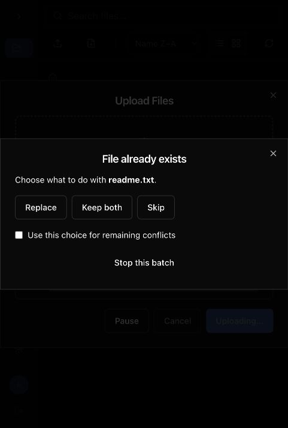

# اصلاحات و امکانات نسخهٔ محلی

تاریخ: 2026-10-26

تغییرات با حفظ ساختار مستقل Go و React فورک پیاده‌سازی شدند. هیچ merge یا cherry-pick از مخزن اصلی انجام نشده است. [گزارش اولیه](upstream-audit-2026-10-26.md) وضعیت پیش از این تغییرات را ثبت می‌کند.

## امکانات

- آپلود به‌صورت قطعه‌ای و ادامه‌پذیر انجام می‌شود. دکمهٔ Pause انتقال را متوقف می‌کند؛ انتخاب دوبارهٔ همان فایل و گزینهٔ Resume، ادامه را از موقعیت تأییدشدهٔ سرور انجام می‌دهد.
- برای شناسایی فایل، نام، اندازه، زمان تغییر و نمونه‌ای از ابتدا و انتهای محتوا مقایسه می‌شوند. این شناسه برای تشخیص فایل است و جای checksum کامل یا احراز هویت را نمی‌گیرد.
- فایل‌های نیمه‌تمام تا ۲۴ ساعت در کش آپلود نگه داشته می‌شوند. در حالت کش حافظه‌ای، راه‌اندازی مجدد سرور امکان ادامهٔ نشست قبلی را از بین می‌برد. قطع پاسخ آخرین قطعه ممکن است نیاز به تازه‌سازی پوشه و بررسی فایل تکمیل‌شده داشته باشد.
- پنجرهٔ حل تداخل، انتخاب Replace، Keep both، Skip و تصمیم یکسان برای تداخل‌های بعدی را فراهم می‌کند. در آپلودِ قابل ادامه، Resume نیز نمایش داده می‌شود. Replace برای کاربر بدون مجوز و برای تداخل با پوشه یا نشست فعال دیگر نمایش داده نمی‌شود.
- آپلود پوشه از انتخابگر پوشه پشتیبانی می‌کند و مسیر نسبی فایل‌ها حفظ می‌شود. رها کردن فایل از بیرون برنامه هم از همین صف آپلود استفاده می‌کند.
- فایل‌های داخل برنامه را می‌توان روی پوشه یا فضای خالی فهرست رها کرد. حالت عادی انتقال است؛ Ctrl یا Command کپی می‌کند. حسابی که فقط مجوز کپی دارد، از حالت کپی استفاده می‌کند. انتقال پوشه به درون خودش رد می‌شود و انتخاب هم‌زمان والد و فرزند دوبار پردازش نمی‌شود.
- مدیر در پنجرهٔ اشتراک فایل، لینک‌های مرتبطِ کاربران دیگر را هم بر اساس محدودهٔ واقعی مالک می‌بیند.
- نوار کناری در ارتفاع کم اسکرول می‌شود. شکست خط زیرنویس SRT با ` ` هنگام تبدیل به VTT حفظ می‌شود.

## اصلاحات دسترسی و امنیت

- فایل‌سیستم محدودشده بر پایهٔ `os.Root` ساخته شده است. خواندن، نوشتن، ساخت پوشه، کپی و تغییر نام نمی‌توانند با دنبال کردن symlink از ریشهٔ مجاز خارج شوند. اشتراک پوشه نیز ریشهٔ محدودشدهٔ جداگانه دارد. پیوندهای نسبیِ داخل محدوده کار می‌کنند؛ پیوند مطلق یا خارج از محدوده دنبال نمی‌شود.
- متن، encoding و checksum بدون مجوز Download ارائه نمی‌شوند. پیش‌نمایش تصویری و متنی نیز همین مجوز را رعایت می‌کنند.
- هنگام استفاده از لینک عمومی، مجوز فعلی Share و Download صاحب لینک دوباره بررسی می‌شود.
- قواعد مبدأ و مقصد همهٔ فرزندان پیش از کپی، انتقال یا حذف بازگشتی بررسی می‌شوند. مسیرهای درخواست، جداکننده‌های سیستم‌عامل و حساسیت واقعی سیستم‌فایل به بزرگی حروف در ارزیابی قواعد لحاظ می‌شوند. قانون پوشه به نام مشابهِ همسایه سرایت نمی‌کند.
- ثبت‌نام Execute و Commands را از پیش‌فرض‌ها به ارث نمی‌برد؛ کاربر تازهٔ proxy نیز Admin و Execute نمی‌گیرد. با فعال بودن ایجاد خانهٔ شخصی، proxy و hook هم خانهٔ جدا دریافت می‌کنند. scope صریح hook حفظ می‌شود.
- برخورد خانه‌های مشتق‌شده از نام کاربر، از جمله تفاوت حروف بزرگ و کوچک، پیش از ثبت حساب و در بخش اتمیک بررسی می‌شود. ایجاد عمدی حساب‌های دارای scope مشترک توسط مدیر همچنان مجاز است.
- توکن منقضی در حالت proxy فقط با هویت معتبر و همسانِ همان پراکسی قابل تمدید است؛ خطاهای امضا یا ساختار توکن نادیده گرفته نمی‌شوند.
- بدنهٔ login/signup حداکثر ۱ مگابایت است. اطلاعات ورود در رشتهٔ فرمان hook جایگذاری نمی‌شود و از طریق environment ارسال می‌شود. وضعیت hook برای هر درخواست جداست.
- پاسخ مدیریت اشتراک، hash رمز یا token سرور را افشا نمی‌کند؛ `hasPassword` و شمارنده‌های اختصاصی فورک حفظ شده‌اند. token اشتراک با مقایسهٔ زمان ثابت بررسی می‌شود. قالب HTML نیز از escaping مناسب استفاده می‌کند.
- نام‌های ZIP دارای backslash خنثی و مسیر entryها اعتبارسنجی می‌شوند. دانلود attachment نوع octet-stream دارد، نام فایل در inline حفظ می‌شود و پاسخ‌ها `nosniff` دارند.
- فایل‌های موقت آپلود و کپی از فهرست و دسترسی عمومی پنهان می‌شوند. پاک‌سازی آپلود نیمه‌تمام از فایل‌سیستم محدودشده انجام می‌شود. HEAD آپلود Redis زمان اعتبار را تمدید می‌کند و درخواست قطعهٔ ردشده با تخلیهٔ محدود بدنه پاسخ داده می‌شود.
- قطعه‌های هم‌زمانِ یک نشست در همین فرایند سری می‌شوند. نشست آپلود به کاربر و مسیر وابسته است و فایل جدیدی که حین انتقال در مقصد ایجاد شود بدون اجازهٔ جایگزینی بازنویسی نمی‌شود.
- API فهرست بازگشتی با رعایت قواعد و لغو درخواست اضافه شده است. خطای یک فرزند غیرقابل‌خواندن، در صورت امکان، فهرست کل پوشه را از کار نمی‌اندازد. upload hook برای ساخت پوشه هم اجرا می‌شود.
- PostCSS از نسخهٔ قفل‌شدهٔ 8.5.8 به 8.5.18 به‌روز شده است. نسخه‌های Go صرفاً به دلیل جدیدتر بودن ارتقا داده نشده‌اند؛ این تغییر وابستگی‌های backend را بی‌دلیل گسترده نمی‌کند.

## رفتارهای حفظ‌شده

نوشتن اتمیک فایل و staging آپلود، حفظ فایل قبلی هنگام خطا، مسیرهای فارسی و دارای درصد و مثبت، نصب در زیرآدرس، ویرایشگر و پیش‌نمایش‌های موجود، شمارنده‌های اشتراک، انتقال مسیر لینک‌ها و حفاظت آخرین مدیر حفظ شده‌اند. اطلاعات کاربر و پایگاه‌دادهٔ اصلی در آزمون‌ها استفاده نشده‌اند.

## اعتبارسنجی و استفاده

کل آزمون‌های Go با `go test -race ./...`، از جمله آزمون اتصال WebSocket، موفق بودند. آزمون‌های نهایی بسته‌های تغییرکرده نیز پس از آخرین اصلاح تکرار و موفق شدند. ۳۰ آزمون رابط، بررسی TypeScript، lint سرور با صفر ایراد و ساخت رابط و فایل اجرایی موفق بودند. ۱۵ آزمون تازهٔ سرور و ۸ آزمون تازهٔ رابط به پروژه اضافه شده‌اند. سناریوهای امنیتی گزارش اولیه اکنون تست بازگشتی با انتظار رفتار امن دارند؛ کپی و آپلود دارای تداخل نام و آپلود واقعی ۹۶ مگابایتی نیز در مرورگر و با دادهٔ موقت بررسی شدند.

تغییرات در نسخهٔ `v0.5.1` ثبت شدند. فایل اجرایی تازه در ریشهٔ پروژه قرار گرفت و فایل قبلی با نام `filebrowser.before-upstream-updates.bak` نگه داشته شد. برای استفاده، فرایند قبلی را ببندید و برنامه را با روش معمول دوباره اجرا کنید. این تغییر مهاجرت پایگاه‌داده ندارد؛ رابط و سرور باید با هم به‌روز شوند، چون پاسخ API مدیریت اشتراک تغییر کرده است. فرایندهای آزمایشی متوقف شدند.

Redis واقعیِ چندنمونه‌ای، تمام سیستم‌فایل‌های ویندوز/شبکه، همهٔ شرایط قطع شبکه و تغییر هم‌زمان فایل‌ها در سیستم‌عامل در این نوبت آزمایش نشده‌اند. این گزارش ادعای حذف همهٔ خطاهای ممکن یا بازنویسی کامل سازوکار نشست و اجرای فرمان نیست.
